<picture>
  <source media="(prefers-color-scheme: dark)"
    srcset="https://raw.githubusercontent.com/priyo09/priyo09/main/dark.svg">

  <source media="(prefers-color-scheme: light)"
    srcset="https://raw.githubusercontent.com/priyo09/priyo09/main/light.svg">

  
</picture>
<h3 data-importer="text" align="center">Hi 👋! My name is Priyantan Ghosh and I'm a Computer Science And Engineering student from Kharagpur, West Bengal</h3>

###

###

  
  
  
  
  
  
  
  
  
  
  
  
  
  
  
  
  

###

  
  
  
  

###

  
  
  

###

  
  
  

###

  
  
  

###

  
  
  

###

  
  
  

###

  

###

  
  
  

###

  

###

  

###
